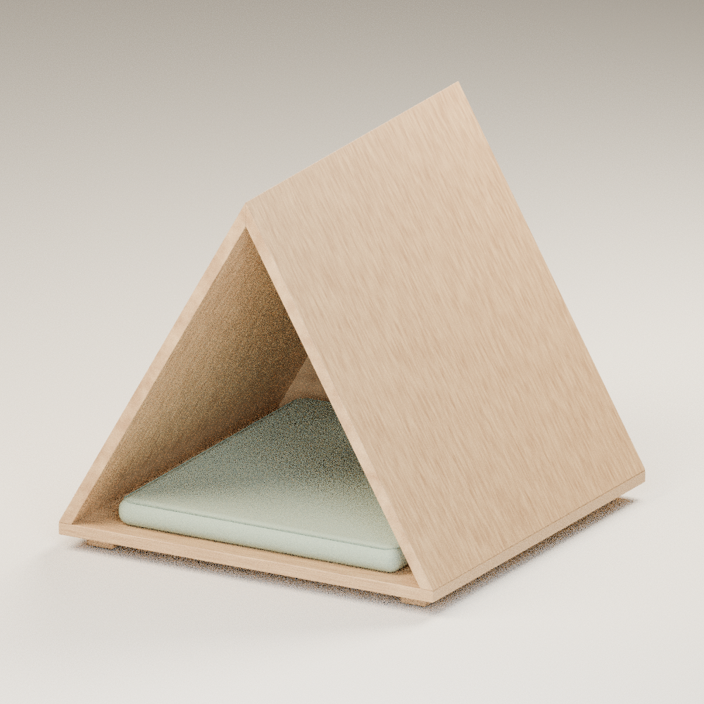

# 帐篷式实木猫窝

尺寸：600 × 600 × 560 mm；18 mm 实木拼板，配绿色软垫。

- [下载 Blender 完整文件包](blender_cat_house.zip?raw=true)
- [下载可编辑 Blender 模型](tent_cat_house.blend?raw=true)
- [下载 CAD 图纸包（STEP / DXF / PDF）](cad_drawings.zip?raw=true)

使用 Blender 4.3 或更新版本打开 `tent_cat_house.blend`。数字键盘 0 切换到摄影机，F12 渲染。木板、软垫和灯光均为独立对象；程序木纹不依赖外部贴图。

此为外观与结构方案，未含五金加工孔位与承载验证。CAD 方案软垫厚30 mm；Blender 展示软垫厚40 mm。
