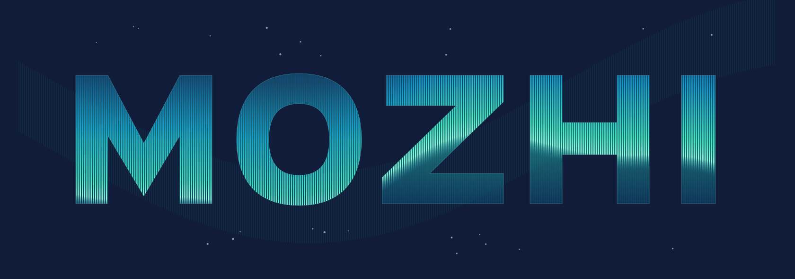

# MOZHI · 极光文字

参考提供图片的深蓝夜空、蓝绿极光、细密竖线，制作横版 MOZHI 字形极光效果。

- 画板按 420 × 148 **毫米**制作（原需求未给单位）；比例 105:37。
- SVG：可在 Adobe Illustrator 中打开编辑。字母已转为路径，极光为矢量渐变线条，无字体依赖、无嵌入位图。
- PDF：矢量交换文件，420 × 148 mm，RGB。
- PNG：1680 × 592 像素预览。
- 如需 420 × 148 像素，按该尺寸导出即可。

## 生成原生 .ai

当前制作环境没有 Adobe Illustrator；交付文件由程序生成并使用 Inkscape 导出，未声称已在 Illustrator 中验证。
将 SVG 和 Save-as-Illustrator.jsx 放在同一目录，在 Illustrator 选择 **文件 → 脚本 → 其他脚本**，运行 JSX，即可由 Illustrator 保存同名的原生 .ai 文件。也可直接打开 SVG 后另存为 .ai。脚本尚未在 Illustrator 实机运行验证。
