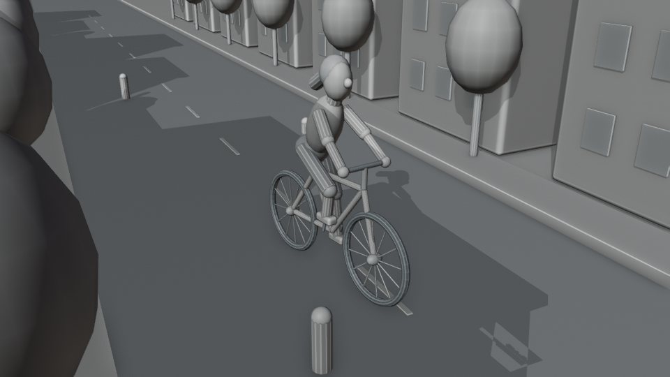

# 白城骑行 / White City Ride



[下载视频](white_city_ride.mp4?raw=true) · [下载 Blender 工程包](white_city_ride_source.zip?raw=true)

Blender 4.3 制作的 15 秒白模骑行短片。成年女性角色骑自行车穿行白色街区，包含连续跟拍、左右转向、车轮滚动与双腿踩踏动画。

- `white_city_ride.mp4`：960×540，24 fps，360 帧，无声。
- `white_city_ride.blend`：可编辑工程，所有模型及关键帧内置，无外部素材依赖。
- `preview.png`：预览图。
- `create_scene.py`：完整场景与动画生成脚本。

## 重新生成

```bash
blender -b -t 3 --python create_scene.py
ffmpeg -framerate 24 -i frames/%04d.png -c:v libx264 -crf 18 -pix_fmt yuv420p -movflags +faststart white_city_ride.mp4
```

使用 Blender Workbench 工作室灯光、阴影与空腔效果呈现白模。角色为程序化风格化模型。所有几何体和动画均由脚本生成。
